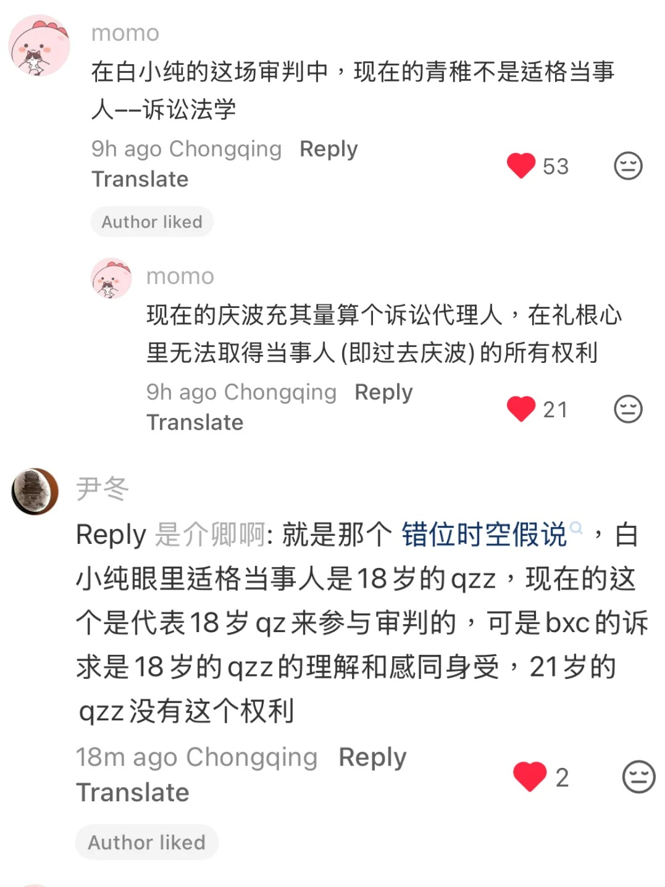
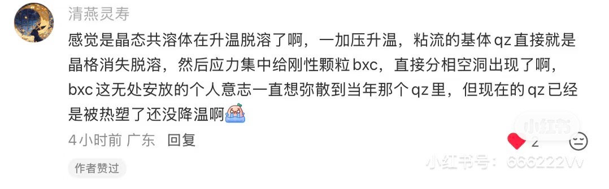
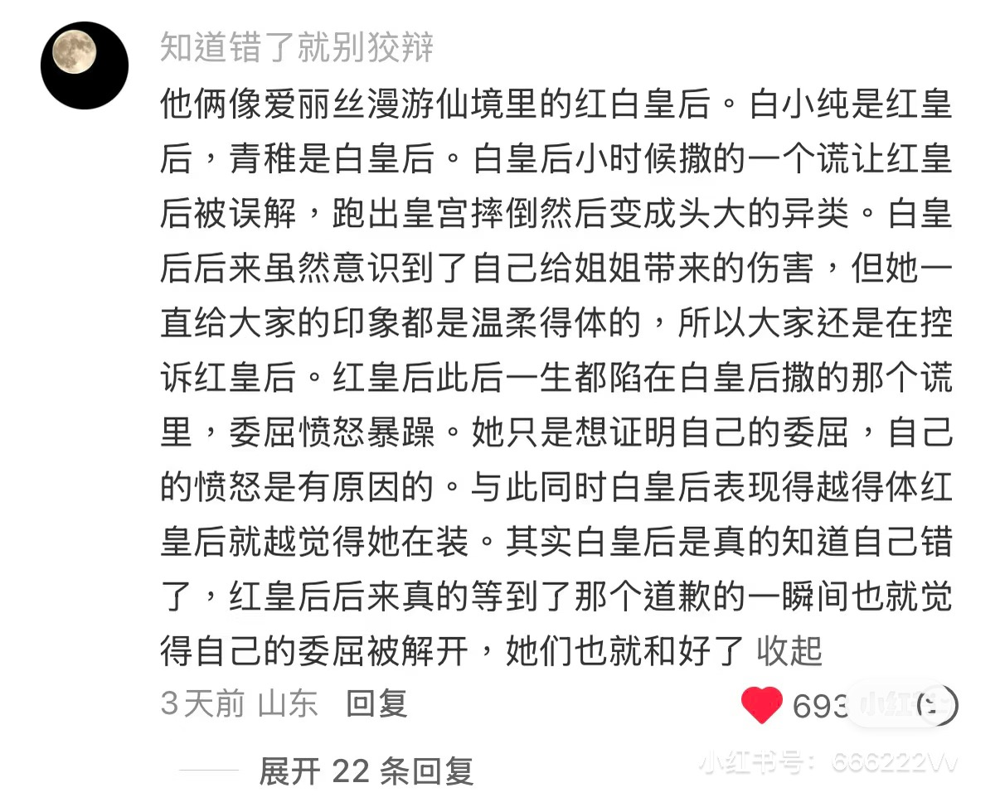
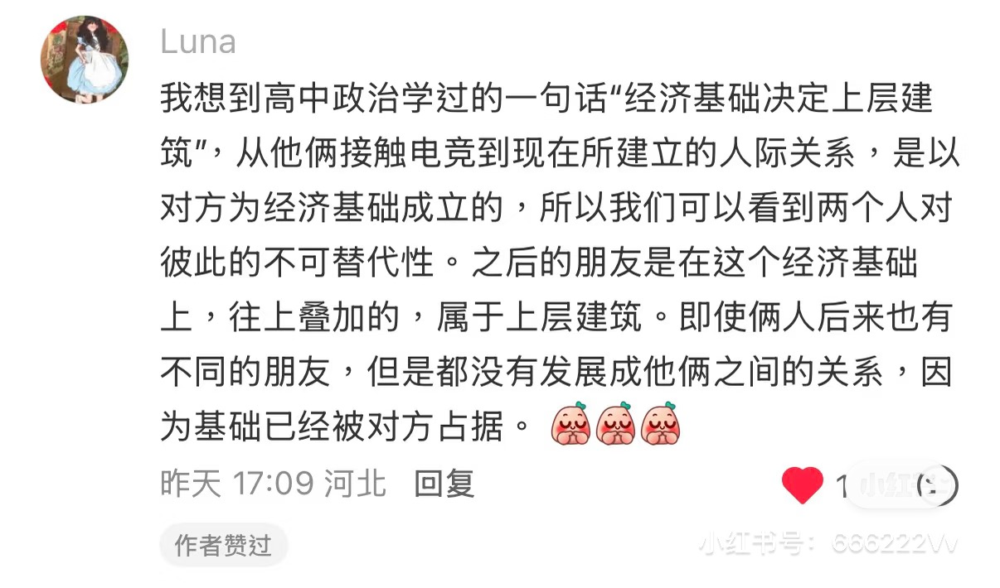

## 课件来源

> [课件来源清单共创说明](./About.md#课件来源清单共创说明)

#### 1. **波根二象性** —— 反比例函数模型

 - [@Gray老师在轨道](https://xhslink.cn/o/6FH5583naVg).[📺试论纯稚与波根二象性](https://xhslink.cn/o/9SrWfKEPiPc).[小红书视频]
 - [@Gray老师在轨道](https://v.douyin.com/2XCCIOnbDfM/).[📺再论波根二象性](https://v.douyin.com/yj2r5WHS9bk/).[抖音视频]
 - [@小八娱乐](https://v.douyin.com/aQyAlCWUoIA/).[📺这个波根二象性会不会太有文化了一点](https://v.douyin.com/c11S-9J8ehE/).[抖音视频]

#### 2. **错位时空假说** —— 相对论

 - [@豆友BuCBWDSqLk](https://www.douban.com/people/279997077/?_i=42011200k7k6l5).[📄白小纯青稚｜纯稚之间的矛盾是白小纯认为青稚把他抛弃在2024年了](https://www.douban.com/group/topic/504861352/?_spm_id=Mjc5OTk3MDc3).[豆瓣图文]

#### 3. **人格分裂假说** —— 临床心理学

 - [@红桃大王](https://v.douyin.com/l2JxN2OOlpo/).[📺《所有人严肃阅读纯稚三种关系假说》](https://v.douyin.com/G2hHKVkEQO0/)（其中第3条即本假说）[抖音视频]

#### 4. **刻舟求剑说** —— 成语寓言

 - [@乞力马扎罗山上的小蔓](https://xhslink.cn/o/5YR0FA5NZcg).[📄怎么会有这么标准的刻舟求剑](https://xhslink.cn/o/1XJKPxcqoae).[小红书图文]

#### 5. **削足适履说** —— 文学隐喻

 - [@慢慢](https://xhslink.cn/o/10IJzUiHCMb).[📄双方削足适履都非要强求的感情](https://xhslink.cn/o/AgoafixQ5kL).[小红书图文]

#### 6. **电竞圈的麦亮说** —— 综艺社会学

 - [@给绿豆冰打钱](https://www.douban.com/people/186092417/).[📄神金病房｜纯稚纯就是麦琳李行亮啊。。。。](https://www.douban.com/group/topic/504749019/?_spm_id=MTg2MDkyNDE3).[豆瓣图文]

#### 7. **痛爽说** —— 行为心理学

 - [@唐马鹿](https://v.douyin.com/Xk5-PxvADHg/).[📺re后会友期·纯稚篇(7)](https://www.iesdouyin.com/share/video/7705278826212773158).[抖音视频]
 - [@唐马鹿](https://v.douyin.com/Xk5-PxvADHg/).[📺re后会友期·纯稚篇(2)](https://www.iesdouyin.com/share/video/7705021839340244264) 计分格式.[抖音视频]
 - [@唐马鹿](https://xhslink.cn/o/3SILIHmxZ6G).[📺【补档】re《后会友期》纯稚1-7合集](https://xhslink.cn/o/551ko4iqAW6).[小红书视频]

#### 8. **伪骨科学说** —— 伦理亚文化

 - [@Chacha](https://www.douban.com/people/286041591/).[📄白小纯青稚｜越品越觉得他俩关系像家里大人没了的伪骨科](https://www.douban.com/group/topic/504728749/?_spm_id=Mjg2MDQxNTkx)及回复区.[豆瓣图文]

#### 9. **四人假说** —— 同一性哲学

 - [@Donor existence](https://xhslink.cn/o/MhnYW4ggHJ).[📺只共情不评价的ob看了真是不烧心](https://xhslink.cn/o/9qHYFXZV7fx) 视频中 4am任 ob.[小红书视频]

#### 10. **俄耳甫斯与欧律狄刻** —— 神话悲剧拆解

 - [@想。](https://xhslink.cn/o/Cq6bMIJ3MR).[📄青稚是不会回头的俄耳甫斯。](https://xhslink.cn/o/46Qw9sQznug).[小红书图文]

#### 11. **仓库论** —— 组织行为学

 - [@火树裂开鸟](https://xhslink.cn/o/3Tkw1tBQIzF).[📺火树刀塔客：史上最适合观察纯稚之人🥥](https://xhslink.cn/o/4YTYS5BOFWi) 视频中 [@火树](https://xhslink.cn/o/4FgOzGrCsu2) ob.[小红书视频]

#### 12. **傲慢与偏见关系论** —— 经典文学

 - [@乐乐](https://www.douban.com/people/283387301/).[📄白小纯青稚｜简·奥斯汀避其锋芒，我们纯稚才是真正的“傲慢”与“偏见”🍬](https://www.douban.com/group/topic/504839843/?_spm_id=MjgzMzg3MzAx).[豆瓣图文]

#### 13. **共轭父子论** —— 数学术语戏仿学说

 - [@恨比爱长久](https://v.douyin.com/v7Vf03U5TC4/).[📄《"共轭父子理论"：双向爹味，互为逆子》](https://www.douyin.com/article/7704647890920082703).[抖音图文]

#### 14. **结果倒推论** —— 传播学

 - [@acelynnn_](https://xhslink.cn/o/2qzSAdYcToY).[📺pel解说姐姐解读纯稚部分～](https://xhslink.cn/o/7Aiu3tDpmpv) 视频中 [@titi又胖了](https://xhslink.cn/o/Ttew939lAm) 解读.[小红书视频]

#### 15. **磁铁论** —— 物理学

 - [@伤心吉尔诺夫](https://xhslink.cn/o/89xWXSDgVZQ).[📺跟你们这些分不清纯稚李麦的人拼了！！！](https://xhslink.cn/o/5kUQy2Xu9Jp).[小红书视频]

#### 16. **教育心理学角度**  —— 教育心理学

 - [@早点睡觉好不好](https://xhslink.cn/o/7ElUQJkcctJ).[📄请从教育心理学角度分析纯稚](https://xhslink.cn/o/3mgw6waMdtu).[小红书图文]

#### 17. **竞男语言表达模式解析** —— 语义学

 - [@titi又胖了](https://xhslink.cn/o/Ttew939lAm).[📺第五期预告刀子解析之丈育竞男](https://xhslink.cn/o/4ki3oLZojfa).[小红书视频]

#### 18. **全国文明宿舍理论** —— 管理学

 - [@妈天生带野](https://xhslink.cn/o/5WbdWjGNAoC).[📺终于有个人给我讲明白了，以后都请像厨子老师这样ob](https://xhslink.cn/o/A7ntO68OYJf) 视频中 [@傅英俊Rex（厨子老师）](https://xhslink.cn/o/9uTRBMsOGY0) ob.[小红书视频]
 - [@李梨梨lili](https://v.douyin.com/C8d6W3eTaH0/).[📺厨子老师锐评：全国文明宿舍评选](https://v.douyin.com/h711OopTbkg/) 视频中 [@傅英俊（厨子老师）](https://v.douyin.com/CUbs5cgbuT4/) ob.[抖音视频]
 - [@林岁岁很多穗](https://v.douyin.com/UwbZP2m5x4I/).[📺通俗易懂的纯稚线·全国文明宿舍评比](https://v.douyin.com/U4cuK5IPWbY/) 视频中 [@傅英俊（厨子老师）](https://v.douyin.com/CUbs5cgbuT4/) ob.[抖音视频]

#### 19. **共用语言系统论证** —— 语言学

 - [@蘑菇唠嗑](https://v.douyin.com/hIEReCMHLPM/).[📺白小纯和青稚可能共用一套语言系统](https://v.douyin.com/XAJij73EXpw/).[抖音视频]

#### 20. **梅拉宾法则** —— 7-38-55法则沟通心理学

 - [@不嗑cp纯分析的老年人。嗑cp的同学别影响不嗑的](https://xhslink.cn/o/5q9rwgKX2TN).[📄从心理学角度re一下悬崖小屋（1/5·看见）](https://xhslink.cn/o/1djwvKmDVxp).[小红书图文]
 - [@不嗑cp纯分析的老年人。嗑cp的同学别影响不嗑的](https://xhslink.cn/o/5q9rwgKX2TN).[📄从心理学角度re一下悬崖小屋（2/5·牢笼） - 可问春风](https://xhslink.cn/o/8xubsL3v4YT).[小红书图文]
 - [@不嗑cp纯分析的老年人。嗑cp的同学别影响不嗑的](https://xhslink.cn/o/5q9rwgKX2TN).[📄从心理学角度re一下悬崖小屋（3/5·盲区） - 可问春风](https://xhslink.cn/o/88tfjXbJDt0).[小红书图文]
 - [@不嗑cp纯分析的老年人。嗑cp的同学别影响不嗑的](https://xhslink.cn/o/5q9rwgKX2TN).[📄从心理学角度re一下悬崖小屋（4/5·锚点） - 可问春风](https://xhslink.cn/o/AQcYZO6nMXU).[小红书图文]
 - [@不嗑cp纯分析的老年人。嗑cp的同学别影响不嗑的](https://xhslink.cn/o/5q9rwgKX2TN).[📄从心理学角度re一下悬崖小屋（5/5·亲友） - 可问春风](https://xhslink.cn/o/7BI8UN24Vs8).[小红书图文]

#### 21. **雏鸟情结/印刻效应** —— 发展心理学

 - [@北笙i奖励](https://xhslink.cn/o/1pISSyqYc9x).[📄看切片有感](https://xhslink.cn/o/83qbt6f0XsH) 评论区.[小红书图文]

#### 22. **从纯稚看《乡土中国》在当代社会的体现** —— 社会学与人类学

 - [@pippo](https://xhslink.cn/o/8kgi7IIlvkn).[📄从纯稚看《乡土中国》在当代社会的体现](https://xhslink.cn/o/4Xr9tL9ka5x).[小红书图文]

#### 23. **黄铜胆瓶论/瓶子里的魔鬼** —— 民间文学童话学

 - [@GUO🍃](https://xhslink.cn/o/5NEKmNvvYbp).[📄我带着黄铜胆瓶理论来了](https://xhslink.cn/o/27eG806HmS).[小红书图文]

#### 24. **pseudo-apology“伪道歉”理论** —— 表达语用学

 - [@1An1](https://xhslink.cn/o/61YIpKZeqgZ).[📄纯稚学的课件大全又名《纯稚怎么翻译？》1.0](https://xhslink.cn/o/7nimkkErq84) 评论区 @舒俱来 留言.[小红书图文]
 - [@莫呼洛迦啊](https://v.douyin.com/EL4-TlHqmoU/).[📺《白小纯：关起门打老婆，出门装老好人！装！》](https://v.douyin.com/-j6FlMJ8vZU/).[抖音视频]

#### 25. **小王子与玫瑰论** —— 存在主义哲学

 - [@滚圆的球球](https://xhslink.cn/o/6weDV1f4sdK).[📄而bxc成长的方式是qz，代价是失去bxc自己，奖励是找回...](https://xhslink.cn/o/6Eej1L4VTbK).[小红书图文]

#### 26. **水手和农民** —— 历史地理学

 - [@不以茉](https://xhslink.cn/o/1yhBOtzUTF6).[📄水手和农民](https://xhslink.cn/o/3SsijIimD17).[小红书图文]

#### 27. **羁绊共价键** —— 化学

 - [@六月盛夏_🥠](https://xhslink.cn/o/AOyCo9spbcS).[📄纯稚某种意义上挺像化学里的共价键的](https://xhslink.cn/o/1yjAahrluyb).[小红书图文]

#### 28. **囚徒困境假说** —— 经济学博弈论

 - [@momo](https://xhslink.cn/o/3y8C3FF41df).[📄用经济学博弈论解释纯稚面临的囚徒困境](https://xhslink.cn/o/1tezIXjfSLA).[小红书图文]

#### 29. **诉讼法学看纯稚审判** —— 法学

 - @momo.[🖼法律法学](诉讼法学.jpg).[网友留言截图]

#### 30. **爱恨共生论** —— 哲学

 - [@迟语者](https://xhslink.cn/o/4hba3vX6mn0).[📄爱恨共生论](https://xhslink.cn/o/1rTR93hcYd5).[小红书图文]

#### 31. **弃猫效应** —— 心理学

 - [@四代唯一南桐](https://www.douban.com/people/235211192/).[📄白小纯青稚｜bxc有没有无意识的对qz使用了弃猫效应心理](https://www.douban.com/group/topic/504645593/?_spm_id=MjM1MjExMTky).[豆瓣图文]

#### 32. **用户需求与场景拆解** —— 设计心理学

 - [@高腰线](https://xhslink.cn/o/81H3hmpG6iH).[📄从设计心理学和用户研究看纯稚](https://xhslink.cn/o/28kLrCPi9TF).[小红书图文]

#### 33. **冲突螺旋与乔哈里窗** —— 冲突社会学

 - [@一只猫鱼干](https://xhslink.cn/o/7WWHGH9DCyn).[📄冲突螺旋不可逆，但乔哈里窗可以移动](https://xhslink.cn/o/AHu0XkPxdYW).[小红书图文]

#### 34. **外儒内法论** —— 传统政治哲学

 - [@momo](https://xhslink.cn/o/9MMEAjGKtfk).[📄萌父酷母即为外儒内法](https://xhslink.cn/o/95Sxh0AzXM0).[小红书图文]

#### 35. **亲密悖论** —— 波根二象性阐述论证

 - [@禾川](https://xhslink.cn/o/8ozMhGku5bR).[📄亲密的悖论：纯稚关系中的依赖、对抗与重构](https://xhslink.cn/o/1GGGEw3aNK3).[小红书图文]

#### 36. **呼啸山庄论** —— 文学互文隐喻

 - [@枝枝葡萄](https://xhslink.cn/o/9WyxYlwQP9t).[📄从呼啸山庄视角看纯稚](https://xhslink.cn/o/9zrGWfLQQbw).[小红书图文]
 - [@把香菜摔打成灰](https://xhslink.cn/o/2YVxjNfeyiP).[📄他们的荒原，和回不去的呼啸山庄](https://xhslink.cn/o/688UXPOjtWZ).[小红书图文]

#### 37. **共生关系论** —— 关系社会学

 - [@皮卡乒](https://xhslink.cn/o/9KfHdzkDXMw).[📺离开共生关系](https://xhslink.cn/o/1TAzIpVX5s).[小红书视频]

#### 38. **晶态共溶体升温论** —— 高分子物理

 - @清燕灵寿.[🖼晶态共溶体升温论](晶态共溶体升温论.jpg).[网友留言截图]

#### 39. **消防安全视角** —— 灾害社会学

 - [@当务之急是活下去](https://xhslink.cn/o/5io0SQ6aHLn).[📄从消防安全视角看纯稚矛盾🧯](https://xhslink.cn/o/5bbI710TS9).[小红书图文]

#### 40. **牛虻内核说** —— 比较文学与文本阐释

 - [@一只猫鱼干](https://xhslink.cn/o/9dISjfQE5dj).[📄从《牛虻》里探寻纯稚的情感内核](https://xhslink.cn/o/7yzvDbAd1x0).[小红书图文]

#### 41. **纯稚标签理论** —— 犯罪学

 - [@悲喜交加荷包蛋](https://xhslink.cn/o/29q3M1S3Ntm).[📄纯稚：关于犯罪学“标签理论”的研究](https://xhslink.cn/o/3GlnhTsR5te).[小红书图文]

#### 42. **传统文化论** —— 面相神韵学

 - [@李也是俗人](https://xhslink.cn/o/84fsON6Limb).[📺从传统文化的角度解析白小纯与青稚](https://xhslink.cn/o/8f0eyunncck).[小红书视频]

#### 43. **从宏观视角来分析纯稚关系**

 - [@随意涂话](https://xhslink.cn/o/1XVjTB98anr).[📄其实我很想站在更宏观的角度来看待纯稚](https://xhslink.cn/o/9UxxiamyXSW).[小红书图文]

#### 44. **纯稚权力运作分析** —— 哲学福柯理论

 - [@磕糖有益身心健康](https://xhslink.cn/o/7qsPrkVqR6b).[📄福柯理论下纯稚关系的权力运作分析](https://xhslink.cn/o/6hR3uD28kpA).[小红书图文]

#### 45. **纯稚阴阳理论** —— 相处行为学

 - [@道可道](https://xhslink.cn/o/2mgRgojemve).[📄基于“阴阳”理论的“纯稚”相处行为学探讨](https://xhslink.cn/o/42NQJzI0CXK).[小红书图文]

#### 46. **波根平衡偏移** —— 化学可逆反应

 - [@七介一哇](https://xhslink.cn/o/2Gas1INVBTj).[📄基于化学可逆反应的波根平衡偏移探究](https://xhslink.cn/o/5n6lOMmxVHZ).[小红书图文]

#### 47. **马斯洛需求层次理论** —— 心理学

 - [@你就是我的世界呀](https://xhslink.cn/o/78s7VmvrrIr).[📄根据马斯洛需求层次理论分析纯稚](https://xhslink.cn/o/1jXQC7yy2iD).[小红书图文]

#### 48. **波根二聚体** —— 生物学

 - [@明天吃啥_🍏^](https://xhslink.cn/o/1Xxu5WuGAKz).[📄从蛋白二聚体角度展开纯稚](https://xhslink.cn/o/7WdGraPTY8V).[小红书图文]

#### 49. **学而不思则罔** —— 天文学洛希极限

 - [@小红薯6A9041D1](https://xhslink.cn/o/6paXZTIWw01).[📄青稚，学而不思则罔](https://xhslink.cn/o/soYz8y7Q3K).[小红书图文]
 - [@小红薯6A9041D1](https://xhslink.cn/o/6paXZTIWw01).[📄白小纯，思而不学则殆](https://xhslink.cn/o/4uaBb2UuhmQ).[小红书图文]

#### 50. **人鬼阴阳论** —— 心理学哀伤辅导

 - [@硬核碱塑流(睡神版)](https://xhslink.cn/o/7cuYLl0lOpV).[📄从“阴间”角度看纯稚和好](https://xhslink.cn/o/AhBZ8TXCaBU).[小红书图文]

#### 51. **微观历史场域论** —— 历史学

 - [@白桃椰椰三分糖](https://xhslink.cn/o/57Il9vxgsF4).[📄从纯稚看微观历史场域下封闭电竞群体的情感](https://xhslink.cn/o/4LJGxT1i5Iq).[小红书图文]

#### 52. **交往形式扬弃论** —— 马克思主义哲学

 - [@凌机一动](https://xhslink.cn/o/1k3QsHjIS6o).[📄纯稚的未来：扬弃旧形式](https://xhslink.cn/o/6o6CATduekv).[小红书图文]

#### 53. **天霸三至尊的依恋性** —— 依恋理论

 - [@Mm](https://xhslink.cn/o/2N4ANWEyMg1).[📄对于天霸一门三至尊的依恋性研究](https://xhslink.cn/o/3h2mH6U7QjF).[小红书图文]

#### 54. **领养关系论** —— 家庭社会学

 - [@小王同学](https://xhslink.cn/o/37KDWBeotC6).[📄纯稚|扭曲的互为领养关系](https://xhslink.cn/o/4AmbiJr5cN1).[小红书图文]

#### 55. **愿望清单解析** —— 心理学

 - [@pippo](https://xhslink.cn/o/3ytzw8G260Y).[📄心理学层面分析白小纯愿望清单中的心理倾向](https://xhslink.cn/o/4amnHFF9cIY).[小红书图文]

#### 56. **影响＞关系论** —— 关系性自我概念

 - [@既白](https://xhslink.cn/o/1bN43CQCMvw).[📄他俩对彼此的影响已经超过关系本身了](https://xhslink.cn/o/kAqeZ01aSN).[小红书图文]

#### 57. **titi圆桌事变解析** —— 跨学科交叉

 - [@titi又胖了](https://xhslink.cn/o/Ttew939lAm).[📺纯稚困境➕圆桌事变解析（个人视角）](https://xhslink.cn/o/1TjBeB6p8lz).[小红书视频]

#### 58. **乡土中国与俄耳浦斯序言** —— 文学解析

 - [@编号7210105](https://xhslink.cn/o/AMs0D7lPIS).[📄拜读《乡土中国》又领略了俄耳浦斯](https://xhslink.cn/o/2GXuQNqu0Cb).[小红书图文]

#### 59. **锁链镣铐论** —— 权力动力学

 - [@Agoni](https://xhslink.cn/o/7UUIHmDPDgI).[📄锁链的另一端是镣铐](https://xhslink.cn/o/r6q299oomD).[小红书图文]

#### 60. **红白皇后说** —— 文学与原型批评

 - @知道错了就别狡辩.[🖼红白皇后说](./红白皇后说.jpg).[网友留言截图]

#### 61. **六个阶段论** —— 传播学

 - [@bananafarmer](https://xhslink.cn/o/8Wa76i5aiC2).[📄纯稚学史官 | 试图从传播学视角记录纯稚舆论走向的6个阶段](https://xhslink.cn/o/6na6cf9mHQf).[小红书图文]

#### 62. **清算真心论** —— 财务分析

 - [@Summer](https://xhslink.cn/o/2PU0Xuvakbb).[📄从财务分析角度拆解纯稚的感情浓度](https://xhslink.cn/o/AtDQLIq8OKC).[小红书图文]

#### 63. **通竞字** —— 语言学

 - [@Gray老师在轨道](https://xhslink.cn/o/6FH5583naVg).[📺浅析通竞字与竞言竞语 附波根二象性角度分析](https://xhslink.cn/o/9WcbAXt01KM).[小红书视频]

#### 64. **经济基础及上层建筑** —— 政治学

 - @Luna.[🖼经济基础及上层建筑](./经济基础及上层建筑.jpg).[网友留言截图]

 

#### 65. **承认的非对称性** —— 哲学

 - [@沐笺昭_重生n次版_](https://xhslink.cn/o/4ELawytVrus).[📄从哲学角度分析纯稚](https://xhslink.cn/o/9JWiwI1RZNU).[小红书图文]
 - [@沐笺昭_重生n次版_](https://xhslink.cn/o/4ELawytVrus).[📄操心、前见、沟通与承认：纯稚哲学（二）](https://xhslink.cn/o/ArswvL8PEEt).[小红书图文]

#### 66. **爱欲与文明论** —— 精神分析学派

 - [@叹渊](https://xhslink.cn/o/4qHDELsD0CU).[📄纯稚理论+1：精神分析学派](https://xhslink.cn/o/7BuO8yUHBE5).[小红书图文]

#### 67. **开心果论** —— 生物学/文学比喻

 - [@仅此时宜](https://xhslink.cn/o/8qWHURbf5im).[📄纯稚开心果论](https://xhslink.cn/o/6JSQfRbaNvM).[小红书图文]

#### 68. **顺其自然综述** —— 跨学科概念戏仿

 - [@倒欠二十斤](https://xhslink.cn/o/6WlWpIkRTQj).[📄我很期待周四啊，白小纯肯定要低头示好，把青稚拉回来...](https://xhslink.cn/o/8QfJcqslZTD).[小红书图文]

#### 69. **借贷论** —— 会计学

 - [@Flyaway.](https://xhslink.cn/o/oEbE4rTLiq).[📄他俩算不算是种有借必有贷，借贷必相等？](https://xhslink.cn/o/1KG5dBYXu9k).[小红书图文]
 - [@Flyaway.](https://xhslink.cn/o/oEbE4rTLiq).[📄以会计学角度解读纯稚总结版](https://xhslink.cn/o/2JljI8rgW1d).[小红书图文]

#### 70. **情感资产负债表** —— 会计学

 - [@Summer](https://xhslink.cn/o/2PU0Xuvakbb).[📄纯稚无限责任公司：一份危险的“情感资产负债表”](https://xhslink.cn/o/9Nmtdw9qZT9).[小红书图文]

#### 71. **游戏血条说** —— 游戏学

 - [@辰见](https://xhslink.cn/o/1iPJ54peZzF).[📄众所周知恐怖游戏最恐怖的部分就是没有血条的怪](https://xhslink.cn/o/4GLuHSlGm04).[小红书图文]

#### 72. **当他们谈论炸牛粪时在谈论什么** —— 依恋理论

 - [@pippo](https://xhslink.cn/o/3ytzw8G260Y).[📄疾痛惨怛，未尝不呼父母也”——青稚在说](https://xhslink.cn/o/49wEsmraceG).[小红书图文]

#### 73. **根据管理学X-Y理论分析纯稚** —— 工商管理学

 - [@小棉花](https://xhslink.cn/o/81KxBlxQlTh).[📄用管理学X-Y理论分析纯稚](https://xhslink.cn/o/7BOgqYQAKQJ).[小红书图文]

#### 74. **感情方程式** —— 化学

 - [@活死蒲公英之王](https://xhslink.cn/o/703Dp4XoA5X).[📄假如从化学反应进程方面来理解？](https://xhslink.cn/o/6SZfiiIhoJv).[小红书图文]

#### 75. **HP双子星透镜论** —— 后现代主义文本分析

 - [@gungun（缺德版）](https://xhslink.cn/o/HHhOL6Qybj).[📄当我用哈利波特视角打开纯稚](https://xhslink.cn/o/6IGJRuvLg2E).[小红书图文]

#### 76. **控制系统论** —— 现代控制原理

 - [@雪葵](https://xhslink.cn/o/2UWLKvlk625).[📄纯稚与控制系统？](https://xhslink.cn/o/2nTECHKgr9h).[小红书图文]

#### 77. **卖菜砍价论** —— 供需理论

 - [@momo](https://xhslink.cn/o/44kxKBD9TCh).[📄纯稚的关系太像卖菜砍价了，刚需才会有要求](https://xhslink.cn/o/476e1IYj7q8).[小红书图文]

#### 78. **单个体多视角论** —— 马克思主义理论

 - [@沐笺昭_重生n次版_](https://xhslink.cn/o/4ELawytVrus).[📄用马克思主义理论单核研究纯稚](https://xhslink.cn/o/5U2Mtr2XHka).[小红书图文]

#### 79. **液态之爱论** —— 社会学

 - [@小e（爬坡中）](https://xhslink.cn/o/7X5ez1kglNq).[📄从社会学视角看液态之爱下的纯稚](https://xhslink.cn/o/7qeLm5reM44).[小红书图文]

#### 80. **西方社会学解析纯稚学**

#### 81. **纯稚灵魂对话论** —— 知识社会学

 - [@方方合](https://xhslink.cn/o/8mhJm0jiKVf).[📄纯稚的灵魂在对话，他人在地狱](https://xhslink.cn/o/UTRCXIrcbD).[小红书图文]

#### 82. **愚人国度论** —— 社会交换理论

 - [@靓仔小树Tolia](https://xhslink.cn/o/4RrbsLGJEV7).[📄爱愚人的国度—纯稚情感分析](https://xhslink.cn/o/4am6k8pKqJM).[小红书图文]

> 大家的产出能力实在是太强了，今天又整理不完了😭

#### 83. **圆桌事变解析** —— 拉康论

#### 84. **约束条件的优解论** —— 拉格朗日乘数法

#### 85. **纯稚情感塑造解析** —— 情感社会学

#### 86. **窄门说** —— 文学隐喻

#### 87. **社会角色理论解释波根二象性**

#### 88. **翻译学理论视角剖析纯稚**

#### 89. **白马非马说** —— 中国古代哲学

#### 90. **纯稚索隐论** —— 文学批评

#### 91. **豌豆杂交实验论** —— 生物学

#### 92. **纯稚相处指南** —— 博物馆学概论

#### 93. **列维纳斯他者伦理视角** —— 哲学

#### 94. **鲁迅文学视角** —— 文学隐喻

#### 95. **绝对吸引，相对排斥** —— Lennard-Jones势能曲线

#### 96. **纯稚关系演变论** —— 药理学配伍理论

#### 97. **论波根二象性的大气热力环流计机制** —— 气象学

#### 98. **纯稚错位论** —— 鲁迅“看与被看”

#### 99. **用神经科学解析纯稚学假说**
